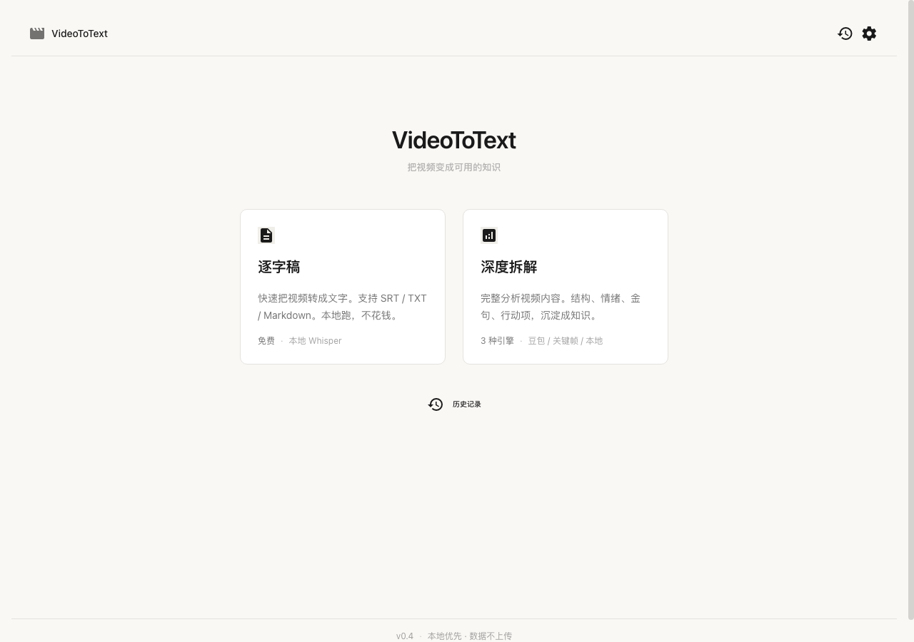

# VideoToText — 本地优先的视频知识萃取器

> 把课程、讲座、纪录片视频转成可检索、可复用的结构化笔记。
> 支持三种引擎、三种模式，GUI + CLI 双模式。

---

## 界面预览



浅色 Parchment 风格，干净克制。功能一目了然。

---

## 这是什么

你买了一堆课程、存了一堆讲座视频，从来没回头看过？

VideoToText 把视频转成**结构化文本**——不只是逐字稿，还有章节摘要、金句、行动项。
存到 Obsidian 里，以后想找什么直接搜，不用再拖进度条。

## 核心亮点

- **本地优先**：所有数据存在本地，API Key 也是你自己的，不上传任何数据到第三方服务器
- **三种转写引擎，按需切换**：
  - **SenseVoice（默认）** — 本地免费，中文准，长音频不重复字
  - Whisper.cpp — 本地免费，备用
  - 飞书妙记 — 免费额度，云端
- **九宫格故事板** — 把视频抽成 3x3 分页图，带时间戳，一张图知道视频讲什么
- **三种画面理解引擎**：豆包视频理解（质量最高）/ 关键帧+VLM（便宜）/ 完全本地
- **批量处理**：拖一整个文件夹进去，自动排队，处理完自动导出
- **蒸馏模式（第三模式）**：整个文件夹丢进去，自动去重、合并逐字稿、抽象方法论，涉及产品还能逆推出架构和商业模式
- **分类资产目录**：每个视频一个文件夹，笔记/转写/故事板分类存放
- **Agent CLI 接口**：别的 Agent（Codex/Claude Code/豆包）可通过 `cli.py --json` 调用
- **Obsidian 原生导出**：直接写入你的 Vault，跟笔记体系无缝衔接
- **缓存机制**：同一个视频不重复付费，结果本地缓存

---

## 三种模式

| 模式 | 输入 | 输出 | 适用场景 |
|------|------|------|---------|
| **逐字稿** | 单个/多个视频 | SRT / TXT / Markdown 带时间戳 | 字幕、速记、全文检索 |
| **深度拆解** | 单个/多个视频 | 摘要 + 章节 + 金句 + 行动项 + 原文引用 | 课程笔记、知识内化、内容创作素材 |
| **蒸馏** | **一个文件夹**（可含子目录） | 去重后的合并逐字稿 + 主题图谱 + 方法论 + 产品逆向 | 买来的一整套课、竞品教程合集、访谈合集 |

### 蒸馏模式做了什么

不是"转文字"，是把一堆散乱视频变成**一份可以拿去决策的认知包**。固定八阶段：

```
S0 采集 → S1 去重 → S2 转写 → S3 合并 → S4 深读 → S5 综合 → S6 抽象 → S7 逆向 → S8 产出
```

- **去重三层**：文件 SHA-256 → 时长+画面 dHash → 逐字稿相似度。同一门课的重录、切片、转码版都能识别
- **合并**：跨视频语句级去重，同一句话被 19 个视频讲过只保留一次，`dedupe_report.md` 里能看到每条视频被砍了多少
- **深读**：每个视频拆成 讲了什么 / 章节 / 可照做的步骤 / 术语 / 硬数字 / 界面线索 / 坑 / 主张
- **方法论**：强制四层——L0 事实 → L1 规律 → L2 方法 → L3 心智模型，**方法卡里出现产品名即判定失败**（那还是操作，不是方法）
- **产品逆向**：涉及产品时，从"能看到的功能"反推模块，从"反复强调的卖点"反推收费，从"必须教的步骤"反推摩擦，输出架构图 + 商业模式 + 复刻路径

方法论细节见 [`docs/distill-method.md`](docs/distill-method.md)。

---

## 快速开始

### 环境要求

- Python 3.10+
- ffmpeg（系统安装：`brew install ffmpeg` 或官网下载）
- （可选）mlx-whisper — Apple Silicon 上快 7 倍，`pip install mlx-whisper`
- （可选）qwen-asr — 中文最强，`pip install qwen-asr`；或配 `DASHSCOPE_API_KEY` 走云端
- （可选）whisper.cpp — 旧本地模式需要

### 安装

```bash
git clone https://github.com/jaminliu89/video-to-text.git
cd video-to-text
pip install -r requirements.txt
```

### 配置

方式一：复制 `.env.example` 为 `.env`，填入你的 API Key

```bash
cp .env.example .env
# 编辑 .env
```

方式二：启动后在 GUI 的「设置」页面配置（推荐，可视化）

### 启动 GUI

```bash
python gui.py
```

浏览器自动打开，开始用。

### 使用 CLI

```bash
# 逐字稿模式（音频转写，最便宜）
python video2text.py 视频路径.mp4

# 深度拆解 + 豆包视频理解
python video2text.py --mode video --deep 视频路径.mp4

# 批量处理整个文件夹 + 导出 Obsidian
python video2text.py --mode audio --deep --obsidian ~/Movies/课程/
```

### 蒸馏整个文件夹（第三模式）

```bash
# 一个文件夹进去，一份认知包出来（默认断点续跑）
python3 cli.py distill ~/Movies/某门课/ --category 课程 --json

# 先试跑 3 个视频看看效果
python3 cli.py distill ~/Movies/某门课/ --max-videos 3

# 不要 LLM，只要去重 + 逐字稿合并（不花钱，快）
python3 cli.py distill ~/Movies/某门课/ --no-llm

# 转写要更准（慢 3-5 倍）
python3 cli.py distill ~/Movies/某门课/ --whisper-model small

# 专有名词总被听错？给张纠错表，比换大模型便宜得多
python3 cli.py distill ~/Movies/某门课/ --hotwords "新约写作=星月写作,新约=星月"
```

产出：

```
output/课程/某门课/
  00_总览.md          # 一页看懂：数字、主题地图、知识单元、冗余、冲突、缺口、学习路径
  01_逐字稿合并.md     # 去重合并后的逐字稿，带 [V03 04:12] 锚点
  02_方法论.md        # 总方法 + 方法卡 + 心智模型 + 决策表 + 质量线
  03_产品逆向.md      # 定位 / 架构(mermaid) / 商业模式 / 复刻路径
  04_证据索引.md      # 硬数字表 + 每个视频的章节/步骤/界面线索/坑/原话
  dedupe_report.md    # 三层去重明细
  distill.json        # 全量结构化数据（给 Agent 用）
  transcripts/        # 单视频逐字稿 md/srt/txt
```

---

## 转写引擎对比

同一段 122 秒中文课程音频实测（Apple Silicon，详见 [docs/asr-engines.md](docs/asr-engines.md)）：

| 引擎 | 参数 | 稳态耗时 | 倍速 | 内存 | 说明 |
|------|------|-----:|-----:|-----:|------|
| **mlx-whisper** | `--asr mlx-whisper --asr-model base` | **1.7s** | **72.6x** | 489MB | 最快，适合粗跑 |
| **mlx-whisper** | `--asr mlx-whisper --asr-model large-v3-turbo` | **5.3s** | **23.1x** | 1144MB | **Apple Silicon 最优解** |
| qwen3-asr | `--asr qwen3-asr --asr-model 0.6b` | 11.5s | 10.6x | 1352MB | 断句标点最好，需 1.2G 权重 |
| faster-whisper | `--asr faster-whisper --asr-model base` | 14.3s | 8.6x | 816MB | 跨平台默认，稳 |
| faster-whisper | `--asr faster-whisper --asr-model small` | 29.5s | 4.2x | 1326MB | CPU 上更准一档 |
| faster-whisper | `--asr faster-whisper --asr-model large-v3-turbo` | 47.7s | 2.6x | 2077MB | CPU 跑大模型太慢 |
| sensevoice | `--asr sensevoice` | — | — | 893MB | 标点好，需 funasr |
| 飞书妙记 | `--asr minutes` | 云端 | — | — | 免费额度，需 lark-cli |

```bash
python3 cli.py engines     # 看这台机器上哪些引擎真能用（缺什么会告诉你）
```

**选型建议**：Apple Silicon 直接用 `mlx-whisper`（turbo 求准、base 求快）；
其他平台用 `faster-whisper`；要断句标点好就用 `qwen3-asr`。

> 换引擎是最后一步。专有名词被系统性听错时，先用 `--hotwords "错词=正词"` 纠正，
> 成本为零、立刻见效。

## Agent CLI 接口（给别的 Agent 调用）

```bash
# 转写
python3 cli.py transcribe video.mp4 --asr sensevoice --json

# 九宫格故事板
python3 cli.py storyboard video.mp4 --json

# 完整管线
python3 cli.py digest video.mp4 --category 课程 --json

# 批量
python3 cli.py batch ./input/ --category 课程 --json

# 蒸馏整个文件夹（第三模式）
python3 cli.py distill ./某门课/ --category 课程 --json

# 列出资产
python3 cli.py list --json

# 看这台机器上有哪些转写引擎可用
python3 cli.py engines --json

# 引擎横向基准（速度 / 内存 / CER / 术语命中）
python3 benchmarks/asr_bench.py --audio clip.wav --engines mlx-whisper:large-v3-turbo,faster-whisper:base
```

所有命令加 `--json`，结果输出到 stdout，日志走 stderr，可直接被 Agent 解析。

## 输出资产结构

```
output/
  <分类>/
    <视频名>/
      <视频名>.md          # 笔记
      <视频名>.json        # 结构化数据
      transcript.json      # 转写 segments
      storyboard_p01.jpg   # 九宫格故事板
      storyboard_index.json
```

---

## 配置说明

完整配置项见 `.env.example`。核心几项：

| 变量 | 说明 | 必填 |
|------|------|------|
| `ARK_API_KEY` | 火山方舟 API Key | 豆包模式需要 |
| `ARK_VIDEO_ENDPOINT` | 豆包视频模型 Endpoint ID | 豆包模式需要 |
| `SILICONFLOW_API_KEY` | 硅基流动 API Key | 关键帧模式需要 |
| `DISTILL_LLM_BASE` / `_KEY` / `_MODEL` | 蒸馏模式用的 LLM（任意 OpenAI 兼容端点，留空自动回落硅基流动/火山方舟） | 蒸馏模式可选 |
| `MLX_WHISPER_MODEL` | mlx-whisper 模型（默认 large-v3-turbo） | Apple Silicon 推荐 |
| `QWEN3_ASR_MODEL` | Qwen3-ASR 模型（0.6b / 1.7b / flash） | 用 qwen3 时需要 |
| `DASHSCOPE_API_KEY` | 阿里云百炼 Key（qwen3-asr-flash 云端） | 云端 qwen3 需要 |
| `WHISPER_CLI` | whisper.cpp 可执行文件路径 | 旧本地模式需要 |
| `OBSIDIAN_VAULT` | Obsidian Vault 路径 | Obsidian 导出需要 |

所有配置也可以在 GUI「设置」页面修改，优先级更高。

---

## 自动同步与分发

### 本地仓库自动同步

```bash
scripts/git-sync.sh                  # pull --rebase → 有改动就 commit → push
scripts/git-sync.sh --pull-only      # 只拉远端（定时更新代码用）
scripts/git-sync.sh --install-hooks  # 装 post-commit 钩子，提交后自动 push
```

想让它定时自动拉：

```bash
# macOS（launchd，每 30 分钟）
sed -e "s|__ROOT__|$PWD|g" -e "s|__HOME__|$HOME|g" \
    scripts/com.video2text.sync.plist > ~/Library/LaunchAgents/com.video2text.sync.plist
launchctl load ~/Library/LaunchAgents/com.video2text.sync.plist

# Linux / 任意系统（cron）
*/30 * * * * /绝对路径/scripts/git-sync.sh --pull-only >> ~/.video2text-sync.log 2>&1
```

### 构建与分发

```bash
scripts/build_release.sh     # 源码包：dist/*.tar.gz / *.zip / SHA256SUMS.txt
scripts/build_dmg.sh         # macOS 安装包：dist/VideoToText-<版本>-<arch>.dmg
scripts/verify_dmg.sh        # 验收 DMG：挂载 → 查结构/静态 ffmpeg → 真的启动一次
```

`build_dmg.sh` 会做四件事：PyInstaller 打成 `VideoToText.app`（one-dir，冷启动 ~2s）→
把静态 ffmpeg/ffprobe 塞进 `Contents/Frameworks/bin/` → ad-hoc 签名 → `hdiutil` 封 DMG
（带 `/Applications` 软链，拖进去就是安装）。没有苹果开发者证书，所以用户首次打开要
**右键 → 打开**；提示"已损坏"时执行 `xattr -dr com.apple.quarantine /Applications/VideoToText.app`。

装好之后：

| 路径 | 内容 |
|---|---|
| `~/Library/Application Support/VideoToText/.env` | 配置（也可用 `VIDEOTOTEXT_HOME` 改目录） |
| `.../VideoToText/cache`、`output` | 转写缓存与产出 |
| `.../VideoToText/app.log` | **启动日志**——窗口模式没有终端，App 打不开就看这个 |

CI 会自动做三件事：

| 触发 | 动作 |
|---|---|
| PR / push main | Linux + macOS(arm64) 双平台检查 → 通过后构建源码包并上传 artifact |
| PR / push main | macOS 上打 DMG → `verify_dmg.sh`（挂载 / 静态链接 / **真的启动一次**）→ 上传 artifact |
| push tag `v*` | 冒烟测试 → 构建源码包 → 创建 GitHub Release |
| push tag `v*` | 打 DMG → 同一套验收 → 附到 Release |

发版：`git tag v0.5.2 && git push origin v0.5.2`

> 打包踩过的坑都写在 `packaging/` 的注释里，最容易复发的是两个：
> ① 入口必须 `import gui; gui.run_app()`（静态 import），用 `runpy` 按路径执行会让
> PyInstaller 的依赖图变成空的，运行时报 `ModuleNotFoundError: nicegui`；
> ② 入口第一条语句必须是 `multiprocessing.freeze_support()`，否则 multiprocessing 的
> 辅助进程会把整个 App 再启动一遍，形成无限自我复制的进程链（详见 `packaging/launcher.py`）。

---

## 项目结构

```
video-to-text/
├── gui.py              # NiceGUI 图形界面
├── video2text.py       # 核心逻辑 + CLI
├── cli.py              # Agent CLI（含 distill 第三模式）
├── config.py           # 统一配置管理
├── v2t/
│   ├── asr.py          # 转写引擎分发
│   ├── storyboard.py   # 九宫格故事板
│   ├── assets.py       # 资产目录
│   ├── ffmpeg.py       # ffmpeg/ffprobe 定位与探测
│   ├── distill.py      # 蒸馏管线（八阶段）
│   └── distill_prompts.py  # 蒸馏用的固定提示词与 schema
├── docs/
│   └── distill-method.md   # 蒸馏方法规范（改了方法就改这里）
├── requirements.txt    # Python 依赖
├── .env.example        # 配置模板
├── cache/              # 处理缓存（自动创建）
└── output/             # 输出目录（自动创建）
```

---

## 路线图

- [x] v0.1 — 音频转写 + CLI
- [x] v0.2 — 三种引擎 + 深度拆解
- [x] v0.3 — NiceGUI 界面 + 批量队列
- [x] v0.4 — 历史记录 + Obsidian 导出 + 缓存
- [x] v0.5 — 蒸馏模式（去重 / 合并 / 方法论 / 产品逆向）+ 多引擎实测 + DMG 分发
- [ ] v0.6 — 说话人分离（diarization）
- [ ] v0.7 — Windows .exe / Linux AppImage
- [ ] v0.8 — 插件系统（自定义输出模板）
- [ ] v1.0 — 稳定版 + 文档站

---

## 贡献

欢迎提 Issue 和 PR。

有 Bug 请附：
1. 操作系统和 Python 版本
2. 报错信息和复现步骤
3. 视频格式（如果是特定文件出问题）

---

## License

MIT
